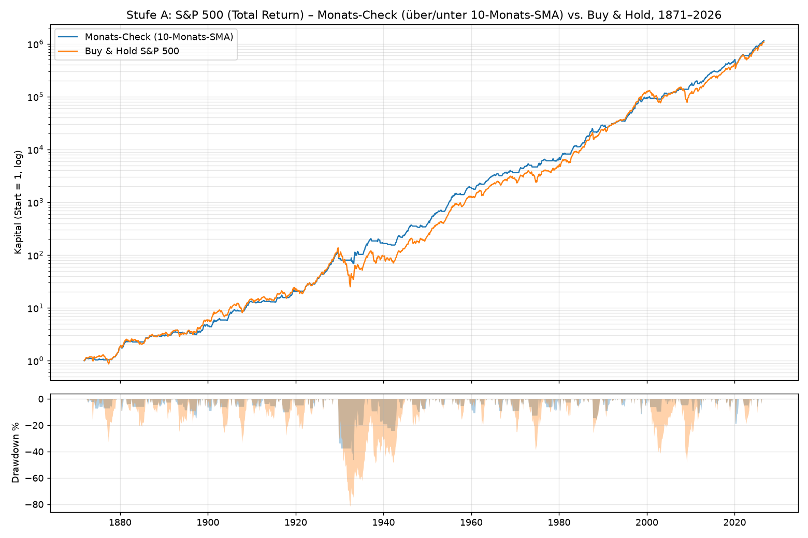
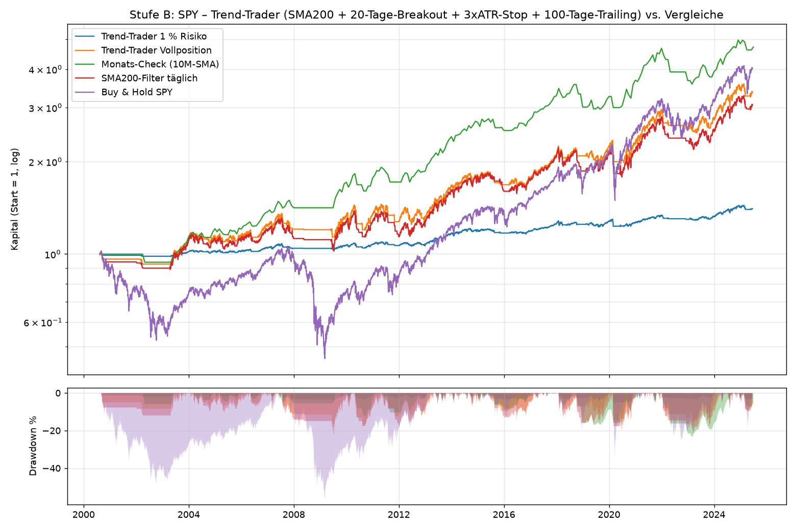

# Was die erfolgreichsten Trader gemeinsam haben – und eine simple Strategie daraus

> Recherche (Stand Oktober 2026), Analyse und ein mechanisches Regelwerk inkl. Backtest über 155 Jahre S&P 500 und 25 Jahre SPY/GLD/QQQ.
> Alles hier ist Bildungsmaterial, keine Anlageberatung. Backtests zeigen die Vergangenheit, nicht die Zukunft.

---

## Kurzfassung (TL;DR)

1. **Die Legenden sind sich uneins über das „Wie“ des Einstiegs, aber fast einig beim Risikomanagement:** Verluste klein halten, Gewinner laufen lassen, pro Trade nur 1–2 % riskieren, nie gegen den Haupttrend handeln, nie bei Verlust nachkaufen, Regeln schriftlich und mechanisch.
2. **Der robusteste, kopierbare Kern ist Trendfolge mit der 200-Tage-Linie** („Nothing good happens below the 200-day moving average“ – Paul Tudor Jones). Das Faber-Timing-Modell (über/unter 10-Monats-Durchschnitt) ist genau das in seiner simpelsten Form.
3. **Die Strategie „Simple Trend“ hat zwei Stufen:**
   - **Stufe A – Monats-Check** (5 Minuten pro Monat, für jeden): ETF-Korb, jeder ETF ist investiert, wenn sein Monatsschluss über dem 10-Monats-Durchschnitt liegt, sonst Cash.
   - **Stufe B – Trend-Trader** (10 Minuten pro Tag, optional): Breakout-Einstieg über dem 20-Tage-Hoch, nur oberhalb der 200-Tage-Linie, 1 % Risiko je Trade, Stop = 3 × ATR, Ausstieg unter 100-Tage-Tief oder unter der 200-Tage-Linie.
4. **Backtest-Ergebnis Stufe A (S&P 500 inkl. Dividenden, 1871–2026):** gleiche Rendite wie Buy & Hold (9,4 % p.a.), aber nur 2/3 der Schwankung, maximaler Rückgang −46 % statt −82 %, **kein einziges Jahr schlechter als −20 % (Buy & Hold: 8 solche Jahre)**. Seit 1950: −19 % statt −49 % maximaler Rückgang.
5. **Backtest-Ergebnis Stufe B (SPY 2000–2025):** 38 Trades, Trefferquote 45 %, Ø Gewinner +2,5 R vs. Ø Verlierer −0,5 R, Profitfaktor 4,3, maximaler Rückgang −17 % (Vollposition) gegenüber −56 % bei Buy & Hold. Ehrliche Einschränkung: Auf einem einzelnen Index bringt Stufe B nicht mehr Rendite als Stufe A – ihr Vorteil liegt in der Verlustbegrenzung je Trade und darin, dass sie sich auf viele Märkte/Aktien skalieren lässt.

---

## Teil 1 – Die erfolgreichsten Trader und ihr Vorgehen

| Trader | Leistung (belegt/zugeschrieben) | Kern-Methode | Was er über Risiko sagt/tut |
|---|---|---|---|
| **Jim Simons** (Renaissance, Medallion) | Ø 66 % p.a. brutto / ca. 39 % netto 1988–2018 – profitabelster Fonds der Geschichte | Rein quantitativ, tausende kleine statistische Vorteile, voll automatisiert | Trefferquote nur **50,75 %** – „aber wir haben zu 100 % recht in 50,75 % der Fälle“; Gewinn kommt aus Positionsgröße und Disziplin, nicht aus Prognosen |
| **George Soros** (Quantum Fund) | 1 Mrd. $ an einem Tag beim Pfund-Short 1992 | Global Macro, Reflexivität, große Wetten bei hoher Überzeugung | Asymmetrische Wetten: viel Gewinn bei kontrolliertem Verlust |
| **Stanley Druckenmiller** (Duquesne) | ~30 % p.a. über 30 Jahre, **kein Verlustjahr** | Macro, konzentrierte Positionen | „Es geht nicht darum, ob du recht hast, sondern wie viel du verdienst, wenn du recht hast, und wie viel du verlierst, wenn nicht.“ Positionsgröße = 70–80 % der Gleichung |
| **Paul Tudor Jones** (Tudor) | Crash 1987 vorhergesagt, Jahrzehnte ohne großes Verlustjahr | Macro + Technik, „play great defense“ | 200-Tage-Linie als Regime-Filter, mindestens 5:1 Chance/Risiko, „losers average losers“ (nie verbilligen) |
| **Richard Dennis / Turtles** | 1.600 $ → 200 Mio. $; seine „Turtle“-Schüler (Anfänger!) verdienten mit seinen Regeln in wenigen Jahren über 100 Mio. $ | Mechanische Trendfolge: 20/55-Tage-Breakouts, ATR-Positionsgröße | 1–2 % Risiko je Einheit, Stop bei 2 × ATR, Trailing-Exit, keine Diskretion |
| **Ed Seykota** | 5.000 $ → 15 Mio. $ (Kundenkonto, 12 Jahre) | Computergestützte Trendfolge, Signale nur zum Tagesschluss | „1. Cut losses. 2. Ride winners. 3. Keep bets small. 4. Follow the rules.“ – < 1 % Risiko je Trade |
| **Jesse Livermore** | ~100 Mio. $ im Crash 1929 | Mit dem Trend, Pyramidisieren in Gewinner, Tape Reading | „Das große Geld liegt im Sitzen“ – Geduld; starb jedoch bankrott: Risiko-Disziplin fehlte am Ende |
| **Nicolas Darvas** | 2 Mio. $ als Tänzer nebenbei | „Box-Theorie“: Kauf beim Ausbruch aus enger Range auf neue Hochs mit Volumen | Enger Stop direkt unter der Box |
| **William O'Neil / Mark Minervini** | O'Neil: CAN-SLIM-Begründer; Minervini: US-Investing-Champion | Momentum-Aktien nahe 52-Wochen-Hoch, über steigenden 50/150/200-Tage-Linien („Trend Template“), Breakout-Einstieg | Harte Verlustgrenze **7–8 % unter Einstieg, ohne Ausnahme**; 1–2 % Risiko |
| **Warren Buffett** | Berkshire Hathaway, rund 20 % p.a. seit 1965 | Qualitätsunternehmen zu fairem Preis, sehr lange halten | „Die Börse transferiert Geld von den Aktiven zu den Geduldigen.“ Regel Nr. 1: kein Geld verlieren |
| **Larry Williams** | 10.000 $ → 1,1 Mio. $ in 12 Monaten (Robbins World Cup 1987) | Kurzfristige Futures, Saisonalität, COT-Daten | Extremer Hebel – ohne strenge Stops nicht überlebbar |

Quellen: [Strike – 32 Best Traders](https://www.strike.money/stock-market/best-traders-in-history), [IG – Most famous traders](https://www.ig.com/en/trading-strategies/world_s-most-famous-traders-190822), [TradersLog – GOATs](https://www.traderslog.com/goats), [finanziell-umdenken (deutsch)](https://finanziell-umdenken.info/die-erfolgreichsten-trader-der-welt-und-ihre-methoden/amp), [Medallion-Zahlen](https://www.readtrung.com/p/jim-simons-and-the-making-of-renaissance), [Quartr – Renaissance](https://quartr.com/insights/edge/renaissance-technologies-and-the-medallion-fund), [Druckenmiller-Zitate](https://traderlion.com/quotes/druckenmiller-quotes/), [PTJ-Prinzipien](https://wyandanchlibrary.com/read/tudor-jones-principles), [Turtle-Regeln (QuantifiedStrategies)](https://www.quantifiedstrategies.com/turtle-trading-strategy/), [Turtle-Regeln (FXOpen)](https://fxopen.com/blog/en/turtle-trading-system-rules-and-strategy/), [Seykota-Regeln](https://dailypriceaction.com/blog/ed-seykota/), [Minervini vs. O'Neil Stops](https://financeyield.in/how-to-set-stop-loss-like-a-pro/), [Minervini Trend Template](https://www.quantvps.com/blog/mark-minervinis-guide-to-finding-winning-stocks).

### Der Gegenpol: Was mit der Mehrheit passiert

Die Legenden sind Überlebende einer brutalen Auslese. Die Forschung zur Masse der aktiven Trader ist eindeutig:

- Brasilien (Chague et al.): **97 %** aller Daytrader, die länger als 300 Tage durchhielten, verloren Geld; nur 1,1 % verdienten mehr als den Mindestlohn – und es gab **keinen Lerneffekt** mit der Erfahrung.
- Taiwan (Barber/Odean): < 1 % der Daytrader waren nach Kosten vorhersagbar profitabel.
- EU (ESMA): **74–89 %** der privaten CFD-Konten verlieren Geld.
- Indien (SEBI): 91 % der privaten Derivate-Trader mit Nettoverlust.

Quellen: [Riskstock – 25 Jahre Forschung](https://riskstock.com/article-why-most-day-traders-lose-money.html), [Failure rates by country](https://bananafarmer.app/research/day-trading-by-country).

**Schlussfolgerung:** Je kurzfristiger und gehebelter, desto sicherer der Verlust. Die Strategie unten ist deshalb bewusst **mittel- bis langfristig, ungehebelt und mechanisch**.

---

## Teil 2 – Analyse: die acht Gemeinsamkeiten

Jack Schwager hat in den *Market Wizards*-Büchern Dutzende Top-Trader interviewt. Sein Fazit: Die Methoden unterscheiden sich komplett (Fundamental, Technik, Quant, Macro), aber **Risikokontrolle und Disziplin sind der gemeinsame Nenner** ([Zusammenfassung 1](https://www.elearnmarkets.com/school/units/market-wizards-interviews-with-top-traders), [Zusammenfassung 2](https://www.mql5.com/en/blogs/post/759681)). Aus der Recherche destilliert:

| # | Prinzip | Wer | Umsetzung in „Simple Trend“ |
|---|---|---|---|
| 1 | **Mit dem Haupttrend handeln, nie dagegen** | PTJ (200-Tage-Linie), Seykota, Dennis, Livermore, Minervini | Kauf nur, wenn Kurs über der 200-Tage-Linie / dem 10-Monats-Durchschnitt |
| 2 | **Verluste klein halten – Stop vor dem Einstieg festlegen** | Alle; O'Neil 7–8 %, Turtles 2 × ATR, Seykota „cutting losses, cutting losses, cutting losses“ | Initial-Stop 3 × ATR (volatilitätsangepasst), Ausstieg mechanisch |
| 3 | **Gewinner laufen lassen** – Rendite kommt aus wenigen großen Trends | Livermore, Seykota, Turtles, Druckenmiller | Kein Kursziel; Ausstieg nur per Trailing-Stop/Trendbruch |
| 4 | **Kleine Einsätze: 1–2 % Risiko je Trade** | Seykota (< 1 %), Turtles (1–2 %), Minervini (1–2 %) | 1 % des Kapitals je Position, Stückzahl aus Stop-Distanz |
| 5 | **Asymmetrie statt Trefferquote** | PTJ (5:1), Druckenmiller, Simons (50,75 % Treffer) | Erwartete Trefferquote ~45 %, Gewinner Ø ≈ 2,5 R |
| 6 | **Nie verbilligen, nie „hoffen“** | PTJ („losers average losers“), O'Neil, Druckenmiller | Nachkauf nur bei Gewinn (optional), nie bei Verlust |
| 7 | **Mechanische Regeln schlagen Bauchgefühl** | Dennis (Turtle-Experiment: Anfänger wurden mit Regeln Millionäre), Simons, Seykota | Alles ist eine Checkliste; kein Ermessen |
| 8 | **Geduld und Nichtstun aushalten** | Buffett, Livermore („sitting“), Faber (einmal im Monat schauen) | Stufe A: nur am Monatsende handeln; Stufe B: 1–2 Signale pro Jahr und Markt |

### Was man **nicht** kopieren kann (und deshalb weglässt)

- **Simons' Edge** (Petabytes Daten, hunderte PhDs, Millisekunden-Ausführung) – für Privatanleger unerreichbar.
- **Soros'/Druckenmillers Macro-Intuition** – Jahrzehnte Erfahrung, Informationszugang, Hebel in Milliardenhöhe.
- **Die „Next Generation Market Wizards“** sitzen 14–16 Stunden täglich vor dem Bildschirm; Schwager selbst hält ihre Fähigkeiten für weitgehend angeboren ([Quelle](https://finance.biggo.com/news/bb71fe897e5c668b)).
- **Was bleibt und nachweislich funktioniert:** die *Regeln* der systematischen Trendfolger (Dennis, Seykota) und der 200-Tage-Filter (PTJ, Faber). Faber hat gezeigt, dass die 10-Monats-SMA-Regel seit 1901 die Rendite des S&P 500 hält, aber Volatilität und Drawdown massiv senkt – „aktienähnliche Renditen mit anleiheähnlichen Schwankungen“, 2008 wurde komplett vermieden ([Paper](https://mebfaber.com/wp-content/uploads/2016/05/SSRN-id962461.pdf), [Update](https://mebfaber.com/2017/12/13/episode-86-quantitative-approach-tactical-asset-allocation/)).

---

## Teil 3 – Die Strategie „Simple Trend“

### Stufe A – Der Monats-Check (Kern; 5 Minuten pro Monat)

**Instrumente:** 4–5 breit gestreute, liquide, ungehebelte ETFs, die sich unterschiedlich verhalten, z. B.

| Baustein | Beispiel-Kategorie | Anteil |
|---|---|---|
| Aktien Welt/USA | MSCI World oder S&P 500 ETF | 20 % |
| Aktien Europa oder Schwellenländer | STOXX Europe 600 / MSCI EM ETF | 20 % |
| Gold | physisch hinterlegter Gold-ETC | 20 % |
| Staatsanleihen lang | Euro-Staatsanleihen 15–30 J. oder US-Treasuries 20+ ETF | 20 % |
| Rohstoffe oder Immobilien | breiter Rohstoff-ETF oder globaler REIT-ETF | 20 % |

**Regel (je Baustein, am letzten Handelstag des Monats):**

```
10-Monats-Durchschnitt = Mittelwert der letzten 10 Monatsschlusskurse
Schlusskurs > 10-Monats-Durchschnitt  ->  investiert (20 % des Kapitals in diesem ETF)
Schlusskurs < 10-Monats-Durchschnitt  ->  Anteil verkaufen, Geld in Tagesgeld/Geldmarkt-ETF
```

- Nur am Monatsende handeln. Was zwischendurch passiert, ist egal (das ist die Regel, die Faber 100+ Jahre getestet hat).
- Es gibt keinen Stop-Loss im klassischen Sinn – der Trendbruch *ist* der Stop.
- Erwartung aus 155 Jahren Daten: Rendite ≈ Buy & Hold, Schwankung ≈ 2/3, maximale Rückgänge etwa halbiert, 1–2 Umschichtungen pro Jahr und ETF.

**Warum das funktioniert:** Große Verluste (−40 % und schlimmer) entstehen praktisch nur in Phasen *unter* dem langfristigen Durchschnitt. Der Filter nimmt dich aus genau diesen Phasen heraus – zum Preis gelegentlicher Fehlsignale (Seitwärtsmärkte wie 2011, 2015, 2018 kosten je ein paar Prozent).

### Stufe B – Der Trend-Trader (optional; 10 Minuten pro Tag nach Börsenschluss)

Für alle, die aktiv *traden* wollen, aber mit den Regeln der Turtles, Seykotas und PTJs. Anwendbar auf 5–10 liquide ETFs (die Bausteine aus Stufe A plus z. B. Nasdaq-100, Bitcoin-ETP) oder auf starke Einzelaktien (Vorauswahl nach Minervini: über steigender 150- und 200-Tage-Linie, nicht mehr als 25 % unter dem 52-Wochen-Hoch).

| Schritt | Regel | Herkunft |
|---|---|---|
| **1. Regime** | Nur kaufen, wenn Schlusskurs **über der 200-Tage-Linie** liegt | Paul Tudor Jones |
| **2. Einstieg** | Schlusskurs **über dem höchsten Hoch der letzten 20 Tage** → Kauf am nächsten Tag zur Eröffnung | Turtles (System 1), Darvas, Livermore |
| **3. Positionsgröße** | Risiko = **1 % des Kapitals**. Stop-Distanz = **3 × ATR(20)**. Stückzahl = (1 % × Kapital) ÷ (3 × ATR). Maximal 25 % des Kapitals je Position, kein Hebel | Turtles („N“), Seykota |
| **4. Initial-Stop** | Einstiegskurs − 3 × ATR. Bei Einzelaktien zusätzlich: nie mehr als 8 % unter Einstieg | Turtles, O'Neil/Minervini |
| **5. Ausstieg** | Verkauf am nächsten Morgen, wenn der Schlusskurs **(a)** unter dem Initial-Stop, **(b)** unter dem **tiefsten Tief der letzten 100 Tage** oder **(c)** unter der **200-Tage-Linie** liegt | Turtles (Trailing-Exit), PTJ (Regime) |
| **6. Verbote** | Nie bei Verlust nachkaufen. Nie Stop nach unten verschieben. Maximal 5 offene Positionen (= max. 5 % Gesamtrisiko) | PTJ, Druckenmiller |
| **7. Verlustserie** | Nach 3 Verlusten in Folge Risiko auf 0,5 % halbieren, bis der nächste Gewinner da ist | PTJ („reduce size when you're cold“), Seykota |
| **8. Journal** | Jeden Trade mit Datum, Grund, R-Ergebnis und Gefühlslage notieren; monatlich auswerten | Seykota („if you can't measure it, you can't manage it“) |

**Beispielrechnung:** Kapital 10.000 €, ETF-Kurs 100 €, ATR(20) = 1,50 €.
Stop-Distanz = 3 × 1,50 = 4,50 € → Initial-Stop bei 95,50 €. Risiko = 1 % × 10.000 = 100 €. Stückzahl = 100 ÷ 4,50 = **22 Stück** (Positionswert 2.200 € = 22 % des Kapitals). Läuft der Trade 20 % ins Plus, sind das +440 € = **+4,4 R** – ein typischer „Trend-Gewinner“, der 8 kleine Verluste bezahlt.

**Was du bei Stufe B erwarten musst (aus dem Backtest, SPY 2000–2025):**

- **Trefferquote ~45 %.** Mehr als die Hälfte der Trades sind kleine Verluste (Ø −0,5 R). Das ist Design, kein Fehler.
- **Die Rendite kommt aus wenigen Trades:** 4 von 38 Trades brachten über 5 R (2012–14, 2016–18, 2020–22, 2023–25) – wer diese verpasst oder zu früh aussteigt, hat eine Verluststrategie.
- **Verlustserien von 4 Trades in Folge** kamen vor; Durststrecken von bis zu 3 Jahren ohne neues Kapitalhoch ebenso.
- **Pro Markt nur 1–2 Signale pro Jahr**, Ø Haltedauer ~5 Monate. Langweilig ist richtig.
- Der 200-Tage-Regime-Exit löst die meisten Ausstiege aus (34 von 38) – gelegentlich als eintägiger Fehlausstieg mit −0,1 R. Das ist der Preis der Einfachheit.

### Das Wichtigste: Die Reihenfolge der Entscheidungen

Jeder Profi in Teil 1 entscheidet zuerst, **wie viel er verlieren darf**, und erst dann, was er kauft. Deshalb:

1. Nur Geld, das 5+ Jahre nicht gebraucht wird; Seykota: maximal 10 % des liquiden Vermögens spekulativ.
2. Stop und Stückzahl **vor** der Order berechnen (`python backtest.py --signal` macht das).
3. Regeln ausdrucken, Trades protokollieren, Regeln frühestens nach 12 Monaten und 30+ Trades anfassen.

---

## Teil 4 – Backtest-Ergebnisse

Alle Zahlen stammen aus `backtest.py` (reproduzierbar, siehe unten). Details, Jahresrenditen, Parameter-Raster und Trade-Liste in [`results/ERGEBNISSE.md`](results/ERGEBNISSE.md).

### Stufe A – S&P 500 inkl. Dividenden, monatlich, Cash unverzinst (konservativ)

| Kennzahl | Monats-Check 1871–2026 | Buy & Hold 1871–2026 | Monats-Check 1950–2026 | Buy & Hold 1950–2026 | Monats-Check 2000–2026 | Buy & Hold 2000–2026 |
|---|---|---|---|---|---|---|
| Rendite p.a. (CAGR) | **9,4 %** | 9,4 % | 10,8 % | 11,5 % | **10,2 %** | 8,8 % |
| Volatilität | **9,5 %** | 14,0 % | **8,8 %** | 12,0 % | **8,7 %** | 12,9 % |
| Sharpe-Ratio | **1,00** | 0,71 | **1,21** | 0,97 | **1,16** | 0,72 |
| Max. Drawdown | **−46 %** (1929–33) | −82 % | **−19 %** | −49 % | **−19 %** | −49 % |
| Längste Durststrecke | 6,2 Jahre | 15,3 Jahre | 2,8 Jahre | 6,2 Jahre | 1,8 Jahre | 5,2 Jahre |
| Zeit investiert | 64 % | 100 % | 72 % | 100 % | 72 % | 100 % |
| Jahre schlechter als −20 % | **0 von 155** | 8 | 0 | 3 | 0 | 2 |



Lesart: Die Strategie gewinnt nicht jedes Jahrzehnt (in starken Bullenmärkten wie den 1990ern kostet sie Rendite), aber sie **eliminiert die Katastrophenjahre** – und genau das ist laut PTJ, Seykota und Buffett der eigentliche Job. Würde Cash mit Geldmarktzins verzinst (wie bei Faber), läge die Rendite der Strategie noch höher.

### Stufe B – SPY täglich, 15.08.2000 bis 16.06.2025 (Kurse ohne Dividenden, 0,05 % Kosten je Seite)

| Kennzahl | Trend-Trader 1 % Risiko | Trend-Trader Vollposition | Monats-Check (Stufe A) | Buy & Hold SPY |
|---|---|---|---|---|
| Rendite p.a. | 1,4 % (Ø nur 18 % des Kapitals investiert) | 5,0 % | **6,5 %** | 5,8 % |
| Volatilität | 2,7 % | 10,2 % | 9,8 % | 19,4 % |
| Sharpe-Ratio | 0,51 | 0,53 | **0,69** | 0,39 |
| Max. Drawdown | **−5 %** | −17 % | −24 % | −56 % |
| Trades | 38 | 38 | 38 Umschichtungen | – |
| Trefferquote | 45 % | 45 % | – | – |
| Ø Gewinner / Ø Verlierer | **+2,5 R / −0,5 R** | +2,5 R / −0,5 R | – | – |
| Profitfaktor | **4,3** | 4,1 | – | – |



**Robustheit über andere Märkte (gleiche Regeln, nichts angepasst):**

| Markt | Trend-Trader Vollposition: CAGR / MaxDD | Trades / Treffer / Ø R / Profitfaktor | Monats-Check: CAGR / MaxDD | Buy & Hold: CAGR / MaxDD |
|---|---|---|---|---|
| SPY 2000–2025 | 5,0 % / −17 % | 38 / 45 % / 0,85 / 4,3 | 6,5 % / −24 % | 5,8 % / −56 % |
| Gold (GLD) 2005–2019 | 8,0 % / −24 % | 20 / 45 % / 1,24 / 4,5 | 6,1 % / −39 % | 8,3 % / −46 % |
| Nasdaq-100 (QQQ) 1999–2018 | 3,2 % / −45 % | 33 / 21 % / 0,28 / 1,6 | 5,1 % / −37 % | 3,5 % / −83 % |

**Robustheit der Parameter (SPY):** Alle 16 getesteten Kombinationen aus Einstieg (20/55 Tage), Ausstieg (10/20/50/100 Tage) und Stop (2/3 × ATR) haben einen positiven Erwartungswert. Klarer Befund: **Enge Trailing-Stops (10/20 Tage – die Original-Turtle-Exits) funktionieren auf Aktienindizes schlecht** (Profitfaktor ~1,5), weite (50/100 Tage) gut (Profitfaktor 2,6–4,3). Ohne 200-Tage-Filter steigt der maximale Drawdown von −17 % auf −40 %.

### Ehrliche Einordnung

- **Stufe A ist auf einem einzelnen Index der Stufe B überlegen** (höhere Rendite, höherer Sharpe). Stufe B lohnt sich erst, wenn man sie auf einen Korb aus 5–10 Märkten/Aktien anwendet (so wie die Turtles 20+ Futures handelten) – dann steigt die Kapitalauslastung, und die Verlustbegrenzung je Position zahlt sich aus. Für die meisten Menschen ist **Stufe A allein die bessere Wahl**.
- Ergebnisse auf QQQ (1999–2018) zeigen: In extremen Crash- und Seitwärtsphasen produziert auch Stufe B Verlustserien. Sie verhindert die Katastrophe (−45 % statt −83 %), aber nicht den Schmerz.
- Nicht enthalten: Steuern (in Deutschland löst jede Umschichtung Abgeltungsteuer aus – das kostet gegenüber Buy & Hold Rendite), Geldmarktzinsen auf Cash (würden helfen), ETF-Ausschüttungen (würden Buy & Hold um ca. 1,5–2 % p.a. besser stellen).
- 25 Jahre Tagesdaten sind **ein** Marktzyklus-Set. Die 155-Jahres-Daten für Stufe A sind der belastbarere Test.

---

## Teil 5 – Was diese Strategie **nicht** ist

- Kein Weg, „schnell reich“ zu werden. Realistische Erwartung: Marktrendite (7–10 % p.a. langfristig) mit etwa halbem Schmerz – nicht die 30–60 % p.a. der Legenden, die mit Hebel, Teams und Jahrzehnten Erfahrung arbeiten.
- Kein Daytrading, keine CFDs, keine Hebelprodukte, keine Optionsscheine. Die Forschung dazu ist eindeutig (Teil 1).
- Keine Prognose. Die Regeln reagieren auf Kurse; sie wissen nicht, warum der Markt steigt oder fällt – und müssen es nicht.
- Kein Ersatz für einen Notgroschen, Schuldenabbau oder Altersvorsorge-Basics.

---

## Checkliste zum Ausdrucken

**Monatsende (Stufe A):**
- [ ] Für jeden ETF: Monatsschluss über dem 10-Monats-Durchschnitt? Ja → halten/kaufen (20 %). Nein → verkaufen, Cash.
- [ ] Order aufgeben, Kalender-Erinnerung für nächstes Monatsende setzen. Fertig.

**Täglich nach Börsenschluss (Stufe B):**
- [ ] Kurs über 200-Tage-Linie? Nein → nichts kaufen; offene Position morgen verkaufen.
- [ ] Schluss über dem 20-Tage-Hoch und noch keine Position? → Stückzahl = (1 % Kapital) ÷ (3 × ATR), Stop = Einstieg − 3 × ATR, morgen zur Eröffnung kaufen.
- [ ] Offene Position: Schluss unter Initial-Stop / 100-Tage-Tief / 200-Tage-Linie? → morgen verkaufen.
- [ ] Mehr als 5 Positionen oder 3 Verluste in Folge? → kein neuer Trade bzw. halbes Risiko.
- [ ] Journal ausgefüllt.

**Immer:**
- [ ] Nie nachkaufen bei Verlust. Nie Stop nach unten verschieben. Nie Hebel. Nie Ausnahmen.

---

## Dateien & Reproduktion

```
trading-strategie/
├── README.md               <- dieses Dokument
├── backtest.py             <- Backtest + täglicher Signal-Check (Python 3.11, pandas, matplotlib)
├── requirements.txt
├── data/
│   ├── SP500_monthly.csv   <- S&P 500 monatlich 1871–2026 inkl. Dividenden (Shiller via github.com/datasets/s-and-p-500)
│   ├── SPY_daily.csv       <- SPY Tagesdaten 1999–2025 (Yahoo Finance via github.com/MarcusJMyrick/Quantitative-Strategy-Engine-QSE-)
│   ├── GLD_daily.csv       <- Gold-ETF 2004–2019 (github.com/quant4junior/algoTrade)
│   └── QQQ_daily.csv       <- Nasdaq-100-ETF 1999–2018 (github.com/11bblandin/quantfiction)
└── results/
    ├── ERGEBNISSE.md       <- alle Tabellen (Jahresrenditen, Parameter-Raster, Trade-Statistik)
    ├── trades_spy_1pct.csv <- jeder einzelne Trade der Stufe B auf SPY
    ├── stufe_a_monatscheck_1871_2026.png
    └── stufe_b_trendtrader_spy.png
```

```bash
cd trading-strategie
python3 -m venv .venv && source .venv/bin/activate
pip install -r requirements.txt

python backtest.py                                   # kompletter Backtest, schreibt results/
python backtest.py --signal --capital 20000          # Was ist heute zu tun? (mit Stückzahl & Stop)
pip install yfinance && python backtest.py --download SPY --signal --capital 20000   # mit frischen Kursen
python backtest.py --csv meine_aktie.csv --signal    # eigene Daten (Spalten: date,open,high,low,close)
```

Für den Monats-Check (Stufe A) braucht es kein Programm: Jede Chart-Software zeigt den 10-Monats-Durchschnitt (Monatschart, SMA 10) bzw. im Tageschart die 200-Tage-Linie.
